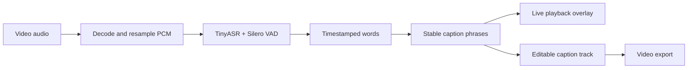

# Live Captions for Telegram iOS

On-device speech recognition for videos in Telegram. Watch videos with synchronized captions, create subtitled Stories, and add editable captions to videos before sending them in a chat.

This is an experimental integration into Telegram-iOS (`feature/live-caption`), powered by [TinyASR](https://github.com/dkaraush/tinyasr). Speech recognition runs locally on the device, without a separate backend or cloud transcription API.

## Features

| | Video Player | Stories Editor | Video Send Editor |
| --- | --- | --- | --- |
| Automatic speech recognition | ✓ | ✓ | ✓ |
| Progressive captions | ✓ | ✓ | ✓ |
| Synchronized playback | ✓ | ✓ | ✓ |
| Edit text and appearance | — | ✓ | ✓ |
| Drag, resize and snap to guides | — | ✓ | ✓ |
| Render captions into exported video | — | ✓ | ✓ |
| Caption generation duration limit | No dedicated five-minute limit | Standard Stories restrictions | 5 minutes |

### Video Player

- Enable or disable captions using the CC control in the video viewer.
- Recognize speech progressively from decoded audio during playback, including supported native and HLS video paths.
- Display short, stable phrases using media timestamps rather than independent wall-clock timers.
- Synchronize captions with playback, pause and seeking; discard outdated recognition results after a seek.
- Keep captions local to the viewer without modifying the original video or sending a transcript to the chat.

### Stories and Video Send Editor

Open **Captions**, select the spoken language and tap **Generate Captions**. A compact progress indicator appears over the video, and recognized phrases become available as generation progresses.

Generated captions can be edited without waiting for the entire transcription to finish:

- **First tap:** pause playback and select the caption.
- **Second tap:** open the native context menu with Edit, Delete and Regenerate actions.
- **Third tap:** open the native inline text editor.

Adjust font, size, color, text style, alignment and position using Telegram's text-editing controls. Drag or pinch the caption to reposition or resize it, with alignment guides for precise placement. Edit individual phrases in the transcript or regenerate the track in another supported language.

Caption appearance is shared across the track; individual phrases retain their own text and timing. Captions are rendered into the exported video, so recipients can see them without installing TinyASR. In the send editor, generation is available for source videos up to **300 seconds (5 minutes)** inclusive.

## Speech recognition engine

[TinyASR](https://github.com/dkaraush/tinyasr), by dkaraush, is a Rust speech recognition library based on compact Zipformer2 models. This integration uses its native C API through a static `TinyASR.xcframework`, linked into Telegram's Bazel build.

- Model: `en-ru-uk` (63M parameters; approximately 31.9 MiB compressed according to upstream).
- Voice activity detection: Silero VAD.
- Audio input: 16 kHz mono PCM for recognition.
- Recognition output: text with word-level timing, punctuation and capitalization.
- Streaming recognition with a persistent session and stable phrase grouping.

The editor currently exposes **English and Russian**. English is preselected for new caption tracks; regeneration retains the previously selected language. The installed multilingual model also supports Ukrainian, but Ukrainian is not exposed in the current editor language picker. Captions transcribe speech; they do not translate it.

### Processing pipeline



The player reads decoded audio from the active playback pipeline. The editors read the video's audio track using AVFoundation. Recognition runs off the main UI thread; committed results are delivered to the preview progressively.

## Build and model setup

This branch uses the existing [Telegram-iOS build system](https://github.com/TelegramMessenger/Telegram-iOS). It is not a standalone SwiftUI app.
```
# clone telegram-ios https://github.com/TelegramMessenger/Telegram-iOS

git checkout 24638bc69b

# apply changes https://github.com/col3name/live-subtitles/blob/main/changes.patch
git apply changes.patch

# follow build instruction at telegram-ios repo
```


## Limitations and development status

- **Duration:** the send editor disables generation for source videos longer than five minutes. Trimming a longer source does not bypass this check. The limit does not apply to the playback overlay or replace Telegram's existing Stories restrictions.
- **Languages:** the editor exposes English and Russian only; this is not universal multilingual transcription or translation.
- **Accuracy and latency:** results depend on speech clarity, background noise, language, buffering and device performance. Progressive captions may lag behind speech, particularly on slower devices or during initialization. Exact on-device latency and resource usage have not been benchmarked.
- **Audio availability:** a decodable audio track is required. Streaming videos still need normal network access to fetch uncached media; recognition itself is offline.
- **Model installation:** both compatible model files must be present. Automatic model download and language-pack management are not documented as implemented.
- **Export:** editor captions are burned into the video, not distributed as a separate selectable subtitle track or SRT/VTT file. Playback captions do not alter the media.
- **Permissions:** recognizing an existing video does not require microphone or camera permission. Recording new media remains subject to Telegram's camera and microphone access rules.
- **Status:** experimental feature branch, not an official Telegram release. Full device testing, export fidelity and performance on five-minute clips still need validation.

## Repos

- [Telegram-iOS](https://github.com/TelegramMessenger/Telegram-iOS) — original client and editing/playback infrastructure.
- [TinyASR](https://github.com/dkaraush/tinyasr) — local speech recognition library and models, licensed upstream under GPL-3.0-or-later.
- [Silero VAD](https://github.com/snakers4/silero-vad) — voice activity detection (MIT).
